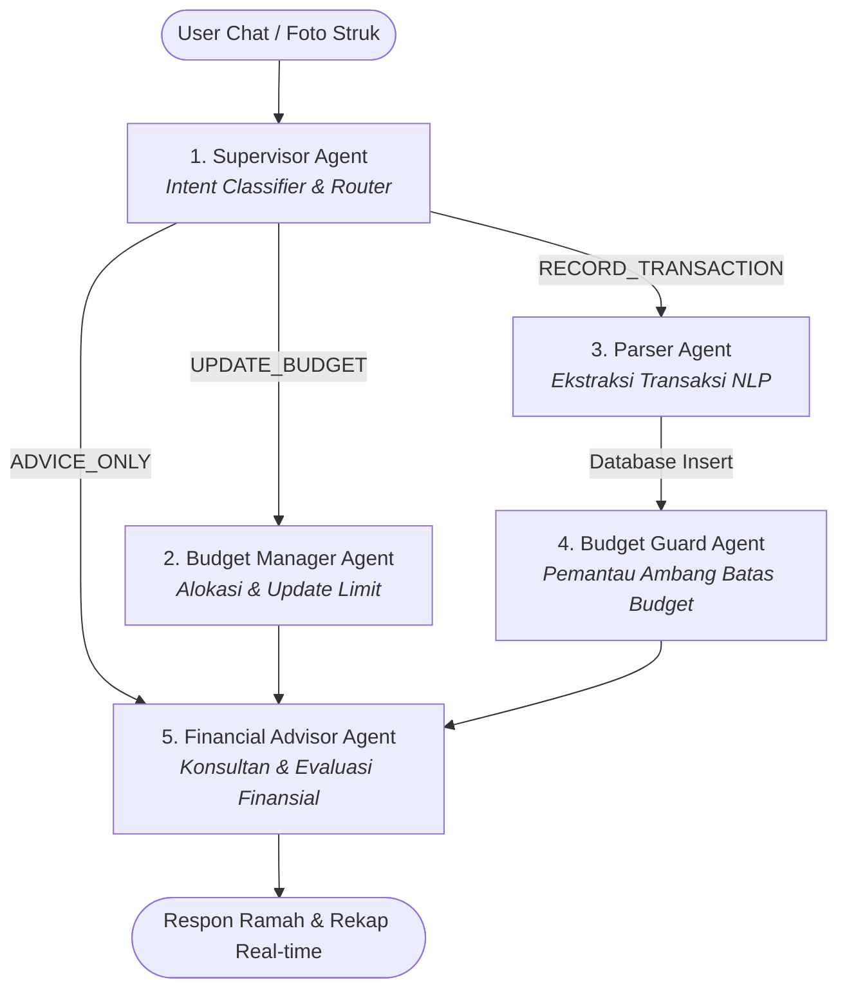

# 🪙 Dompetku — Multi-Agent System (MAS) Financial Tracking

Sistem pelacak dan asisten manajemen keuangan cerdas berbasis **Multi-Agent System (MAS)** menggunakan **LangGraph**, **Google Gemini**, dan database **Supabase**. Terintegrasi secara *real-time* dan *omnichannel* antara **Bot Discord (Fly.io)** dan **Web App (Next.js / Vercel)**.

---

## 🌟 Arsitektur & Konsep Multi-Agent System

Sistem ini tidak hanya menggunakan satu prompt AI statis, melainkan arsitektur **Graph-based State Machine** berbasis **LangGraph**. Setiap agen memiliki tanggung jawab spesifik (*single responsibility principle*) dan berkolaborasi dalam satu siklus pipeline.



---

## 🤖 Peran & Tanggung Jawab Agen

### 1. 🎯 Supervisor Agent (Orchestrator)
* **Peran:** Menjadi pintu gerbang pertama yang menganalisis pesan bahasa natural user.
* **Fungsi:** Mengklasifikasikan intensi user secara dinamis:
  * `RECORD_TRANSACTION`: Mencatat pengeluaran atau pemasukan baru.
  * `UPDATE_BUDGET`: Mengubah batasan budget bulanan.
  * `ADVICE_ONLY`: Bertanya saldo, tips hemat, evaluasi keuangan bulanan.
  * `MULTI`: Menangani pesan kombinasi (misal: catat belanjaan sekaligus tanya saldo).

### 2. 📝 Parser Agent (Transaction Extractor)
* **Peran:** Spesialis pemrosesan bahasa alami (NLP) untuk transaksi keuangan Indonesia.
* **Fungsi:**
  * Mengekstrak entitas: `nama transaksi`, `jumlah/nominal`, `tipe (income/expense)`, dan `kategori`.
  * Memahami bahasa gaul/slang Indonesia (*"tadi siang makan ayam geprek 25rb"*, *"dapet cuan freelance 1.5jt"*, *"bayar indihome 380k"*).
  * Menyimpan transaksi langsung ke database Supabase secara aman menggunakan `user_id` pemilik akun.

### 3. 🛡️ Budget Guard Agent (Anomaly & Threshold Sentinel)
* **Peran:** Pengawas kepatuhan anggaran secara otomatis setiap kali ada pengeluaran baru.
* **Fungsi:**
  * Menghitung akumulasi pemakaian kategori berjalan terhadap limit budget.
  * Memberikan status peringatan:
    * 🟢 **Aman** (< 80% limit).
    * 🟡 **Peringatan** (≥ 80% mendekati limit).
    * 🔴 **Bahaya / Overbudget** (> 100% melampaui limit).

### 4. ⚙️ Budget Manager Agent (Budget Controller)
* **Peran:** Pengelola limit anggaran dinamis via percakapan santai.
* **Fungsi:**
  * Memproses permintaan seperti: *"atur budget makan jadi 1.2 juta"* atau *"naikkan limit tagihan jadi 500rb"*.
  * Mengupdate parameter profil anggaran di Supabase secara *real-time*.

### 5. 💡 Financial Advisor Agent (Consultant & Responder)
* **Peran:** Penyusun respon akhir yang ramah, santun, dan solutif.
* **Fungsi:**
  * Mengagregasi data ringkasan transaksi, status guard, dan saldo akun.
  * Memberikan rekomendasi finansial praktis sesuai kondisi keuangan pengguna.

---

## 🔄 Sinkronisasi Omnichannel (Discord ↔ Web)

Sistem ini menghubungkan pengguna di berbagai platform secara *seamless*:

1. **Akun Terpusat (Supabase Auth & PostgreSQL):**
   * Transaksi yang dicatat lewat Discord otomatis muncul di Dashboard Web.
   * Struk belanja yang di-scan di Web via fitur *Scan Struk* (Gemini Vision) langsung terbaca oleh Bot Discord.
2. **Penautan Akun Aman (Stateless HMAC Token):**
   * Menggunakan slash command `/link` di Discord.
   * Diberikan token berumur pendek (15 menit) bertanda tangan kriptografis (**HMAC-SHA256**) yang aman dari pemalsuan dan kompatibel dengan arsitektur *Serverless Vercel*.

---

## 🗂️ Struktur Proyek

```text
Dompetku MAS/
├── agents.py           # Definisi StateGraph LangGraph & implementasi 5 agen AI
├── database.py         # Lapisan integrasi Supabase (PostgreSQL client & query helper)
├── discord_bot.py      # Handler Discord Bot (Slash commands: /link, /unlink, /status, on_message)
├── main.py             # Entrypoint kompilasi LangGraph workflow & runner CLI lokal
├── Dockerfile          # Kontainerisasi bot untuk deployment Fly.io
├── fly.toml            # Konfigurasi deployment serverless machine di Fly.io
└── requirements.txt    # Dependensi Python (langgraph, langchain, discord.py, supabase, httpx)
```

---

## 🛠️ Panduan Menjalankan Bot di Lokal

### 1. Prasyarat
* Python 3.10+
* Akun & Database Supabase
* Discord Bot Token (dari Discord Developer Portal)
* Google Gemini API Key

### 2. Konfigurasi Environment (`.env`)
Buat file `.env` di dalam folder ini:
```env
GEMINI_API_KEY=your_gemini_api_key
DISCORD_TOKEN=your_discord_bot_token

# Supabase Credentials
SUPABASE_URL=https://xxxx.supabase.co
SUPABASE_SERVICE_KEY=your_supabase_service_role_key

# Integrasi Web
BOT_API_SECRET=your_bot_secret_token
APP_URL=https://dompetku-hazel.vercel.app
```

### 3. Instalasi Dependensi
```bash
pip install -r requirements.txt
```

### 4. Uji Coba Mode CLI (Terminal)
Untuk mengetes respon multi-agent tanpa Discord:
```bash
python main.py
```

### 5. Menjalankan Bot Discord
```bash
python discord_bot.py
```

---

## 🚀 Deployment ke Fly.io (24/7 Cloud)

1. **Deploy ke Fly.io:**
   ```bash
   fly deploy
   ```
2. **Set Environment Secrets di Fly.io:**
   ```bash
   fly secrets set SUPABASE_URL="..." SUPABASE_SERVICE_KEY="..." BOT_API_SECRET="..." APP_URL="..."
   ```
3. **Cek Log Real-Time:**
   ```bash
   fly logs
   ```

---

## 📜 Perintah Bot Discord

| Command | Keterangan |
| :--- | :--- |
| `/link` | Menghasilkan tautan verifikasi untuk menghubungkan akun Discord ke Web Dompetku |
| `/status` | Mengecek apakah akun Discord sudah terhubung ke akun web |
| `/unlink` | Memutuskan hubungan akun Discord dari Dompetku |
| *Ketik Pesan Langsung* | Catat transaksi (*"Beli kopi 25rb"*), ubah budget (*"Set budget makan 1jt"*), atau tanya saldo/tips |
