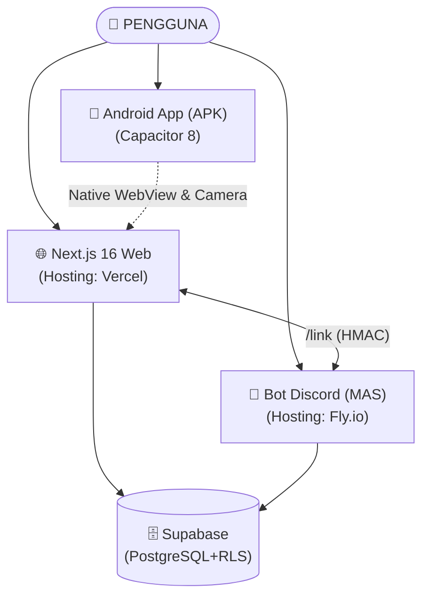

# 👛 Dompetku — AI Financial Assistant & Omnichannel Expense Tracker

**Dompetku** adalah platform manajemen dan pelacakan keuangan pribadi berbasis **Multi-Agent System (AI)** yang menghubungkan **Web Application** modern, **Aplikasi Mobile Android (APK)**, dan **Bot Discord 24/7**.

Sistem ini membantu pengguna mencatat pengeluaran, memantau batas anggaran (*budget limit*), membaca struk belanja otomatis via OCR kamera, dan mendapatkan konsultasi keuangan secara otomatis melalui percakapan santai.

---

## ⚡ Fitur Utama

- 🤖 **Multi-Agent AI System (LangGraph + Gemini):** Kolaborasi 5 agen AI khusus (Supervisor, Parser NLP, Budget Guard, Budget Manager, dan Financial Advisor) untuk memproses teks bahasa Indonesia informal menjadi pencatatan keuangan terstruktur.
- 📱 **Omnichannel Sync (Android ↔ Discord ↔ Web):** Akses lewat aplikasi native Android di ponsel, catat transaksi via chat Discord saat bepergian, atau pantau visualisasi analisis grafik di dashboard web. Semua data tersinkronisasi *real-time*.
- 📸 **Scan Struk Belanja (AI Vision OCR):** Unggah atau foto struk belanjaan langsung dari kamera HP untuk mengekstrak nama toko, tanggal, nominal, dan kategori secara otomatis menggunakan Gemini Vision.
- 🛡️ **Budget Guard & Anomaly Detection:** Sistem proteksi otomatis yang mengingatkan pengguna jika pengeluaran kategori tertentu telah mendekati atau melebihi limit bulanan.
- 🔒 **Keamanan Terjamin (Supabase Auth & RLS):** Database PostgreSQL dengan *Row Level Security* (RLS) memastikan setiap pengguna hanya memiliki akses ke data keuangannya sendiri.
- 🔗 **Penautan Akun Aman (Stateless HMAC Token):** Menghubungkan bot Discord ke akun web menggunakan tanda tangan digital kriptografis HMAC-SHA256 yang aman dan kompatibel dengan arsitektur serverless.
- 🚀 **Automated CI/CD APK Build:** Build file APK Android otomatis di cloud menggunakan GitHub Actions tanpa membutuhkan instalasi Android Studio lokal.

---

## 🏗️ Arsitektur Teknologi



| Komponen | Teknologi | Hosting / Platform |
| :--- | :--- | :--- |
| **Frontend Web** | Next.js 16 (App Router), React 19, Tailwind CSS v4, Lucide | [Vercel](https://vercel.com) |
| **Mobile App (Android)** | Capacitor.js 8, Android SDK, Gradle, GitHub Actions | APK Artifacts (GitHub CI) |
| **Multi-Agent System** | Python 3.11, LangGraph, LangChain, Discord.py | [Fly.io](https://fly.io) |
| **Model AI** | Google Gemini (`gemini-3.1-flash-lite`), Gemini Vision | Google AI Studio |
| **Database & Auth** | PostgreSQL, Row Level Security, Supabase Auth | [Supabase](https://supabase.com) |

---

## 📱 Aplikasi Android (APK)

Dompetku mendukung instalasi native di smartphone Android menggunakan **Capacitor.js** yang terhubung langsung ke deployment produksi Vercel (`https://dompetku-hazel.vercel.app`).

### Keunggulan:
1. **Over-The-Air (OTA) Auto-Update:** Setiap pembaruan tampilan di web otomatis tampil di aplikasi HP tanpa perlu build ulang APK.
2. **Native Device Access:** Terintegrasi dengan izin kamera dan media storage untuk fitur pemindaian nota struk.
3. **Cloud Build Otomatis:** File APK di-build otomatis di cloud oleh GitHub Actions dalam ~2 menit.

### Cara Download File APK:
1. Masuk ke tab **[Actions](https://github.com/AruviUwU/Dompetku/actions)** di repositori GitHub.
2. Pilih workflow run terbaru pada **Build Android APK**.
3. Di bagian bawah (*Artifacts*), klik dan unduh **`Dompetku-Debug-APK`**.
4. Ekstrak file zip dan install file `app-debug.apk` di smartphone Android Anda.

---

## 🤖 Multi-Agent Workflow (LangGraph)

Dokumentasi lengkap mengenai cara kerja 5 agen AI dapat dilihat pada:
👉 [**Dokumentasi Lengkap Multi-Agent System (Dompetku MAS)**](./Dompetku%20MAS/README.md)

1. **Supervisor Agent:** Menganalisis niat user dan mengarahkan ke agen yang tepat.
2. **Parser Agent:** Mengekstrak nominal, tipe, dan kategori dari bahasa santai/gaul (*"beli nasgor 25rb"*).
3. **Budget Guard Agent:** Memantau ambang batas pengeluaran kategori (Aman, Waspada, Overbudget).
4. **Budget Manager Agent:** Mengubah limit alokasi anggaran via percakapan.
5. **Financial Advisor Agent:** Memberikan evaluasi keuangan dan saran cerdas.

---

## 🚀 Memulai Proyek (Local Development)

### 1. Web Application (Next.js) & Capacitor
```bash
# Masuk ke root directory
cd Dompetku

# Install dependencies (pnpm)
pnpm install

# Buat file .env.local dan isi:
# GEMINI_API_KEY=...
# NEXT_PUBLIC_SUPABASE_URL=...
# NEXT_PUBLIC_SUPABASE_PUBLISHABLE_KEY=...
# SUPABASE_SERVICE_ROLE_KEY=...
# BOT_API_SECRET=...
# NEXT_PUBLIC_APP_URL=http://localhost:3000

# Jalankan dev server
pnpm dev

# Sinkronisasi konfigurasi Capacitor Android (opsional)
pnpm cap:sync
```

Buka [http://localhost:3000](http://localhost:3000) di browser.

### 2. Discord Bot Multi-Agent System
```bash
# Masuk ke folder bot
cd "Dompetku MAS"

# Install dependensi Python
pip install -r requirements.txt

# Buat file .env (lihat template di Dompetku MAS/.env.example)

# Jalankan Bot Discord
python discord_bot.py
```

---

## 🤖 Gunakan Bot Discord di Servermu

Invite bot Dompetku ke server Discord kamu:

👉 **[Invite Bot Dompetku](https://discord.com/oauth2/authorize?client_id=1561585645426573312&permissions=2147567616&integration_type=0&scope=bot)**

### Setup (Admin Server)
1. Klik link invite di atas dan pilih server tujuan
2. Di channel yang diinginkan, ketik `/setchannel` untuk mengaktifkan bot di channel tersebut
3. Bot akan mengirim pesan konfirmasi — member sudah bisa mulai pakai!

### Untuk Member
1. Ketik `/link` untuk menghubungkan akun Discord ke Dompetku Web
2. Langsung kirim pesan seperti *"Beli kopi 25rb"* atau *"Gajian 5jt"* di channel yang sudah di-set
3. Cek status koneksi dengan `/status`

> **Catatan:** Bot hanya akan merespons di channel yang sudah di-set oleh admin. Slash commands (`/link`, `/status`, dll) tetap bisa dipakai di channel manapun.

---

## 📄 Lisensi
Dibuat dengan ❤️ untuk membantu pengelolaan keuangan pribadi menjadi lebih mudah, tenang, dan cerdas.
